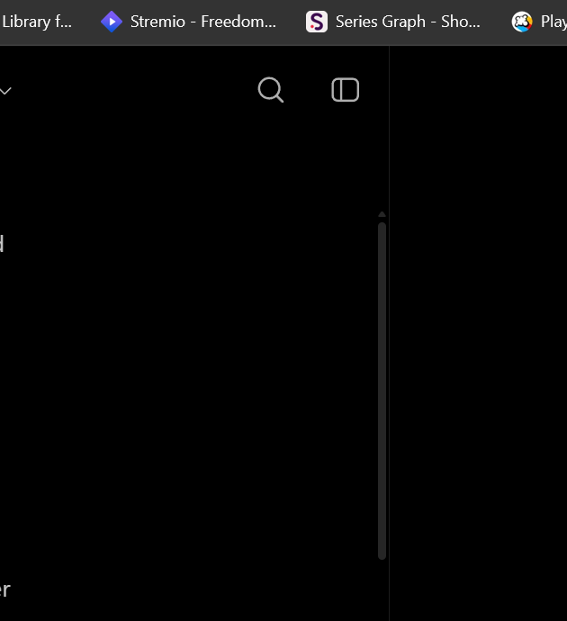
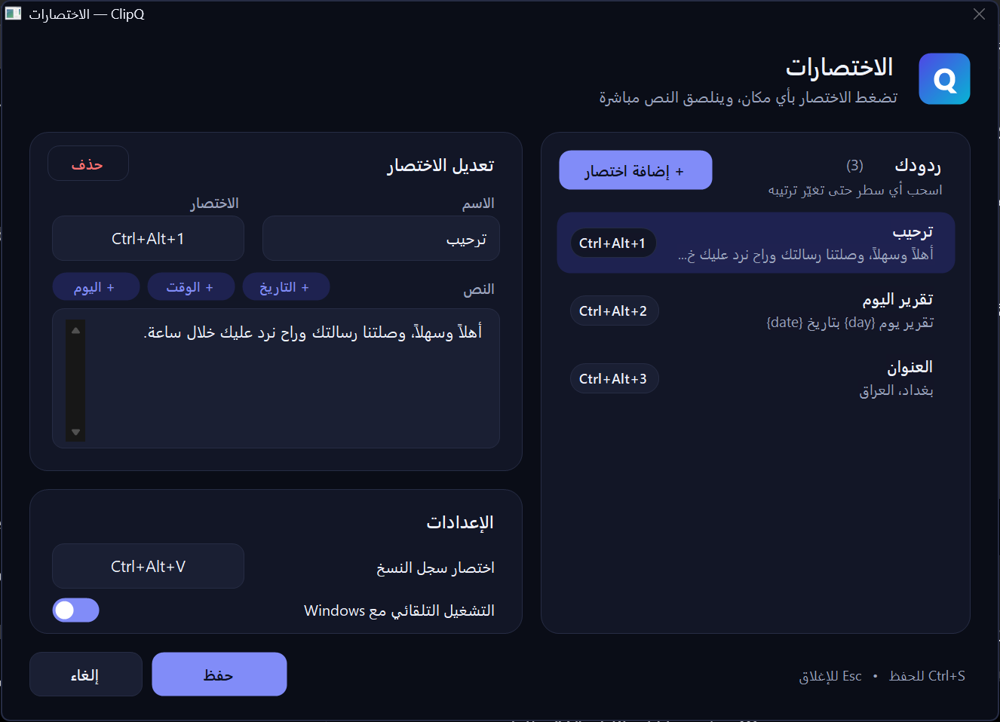

<div dir="rtl">

<div align="center">


# ClipQ

**سجل النسخ والردود الجاهزة على Windows.**

اضغط اختصار، واختر أي شي نسخته، وينلصق مباشرة بالمكان اللي تكتب بيه.

[English](README.md) · **العربية**

[](https://github.com/visions4hub/ClipQ/actions/workflows/build.yml)
[](https://github.com/visions4hub/ClipQ/releases/latest)

[](LICENSE)

[**⬇ تحميل (العربية)**](https://github.com/visions4hub/ClipQ/releases/latest/download/ClipQ-Setup-AR.exe) &nbsp;·&nbsp; [**⬇ Download (English)**](https://github.com/visions4hub/ClipQ/releases/latest/download/ClipQ-Setup-EN.exe)

</div>

---

## صور البرنامج

| سجل النسخ (`Ctrl+Alt+V`) | الاختصارات والإعدادات |
|:---:|:---:|
|  |  |

## المميزات

- **سجل النسخ:** يحفظ آخر 200 نص نسخته. تفتحه من أي مكان، وتبحث بيه، وتلصق.
- **التثبيت:** العناصر المهمة تثبّتها، فتبقى فوك وما تنمسح ويا السجل.
- **ردود على اختصار:** تحفظ النصوص اللي تكتبها هواية، وتعطي لكل نص اختصار خاص بيه، فينلصق مباشرة بالبرنامج اللي إنت بيه.
- **متغيرات ذكية:** `{date}` و `{time}` و `{day}` تنملي تلقائياً وقت اللصق.
- **عربي وإنكليزي:** نسختين، الواجهة العربية من اليمين لليسار، والإنكليزية من اليسار لليمين.
- **يحترم الباسوردات:** أي شي تعلّمه برامج الباسوردات كسري ما ينحفظ.
- **خصوصيتك محفوظة:** كل شي يبقى على حاسبتك، والبرنامج ما يتصل بالإنترنت نهائياً.
- **شكل أصلي:** يتبع الوضع الفاتح والداكن بـ Windows، وحواف Windows 11 المدورة، ويدعم الشاشات عالية الدقة.
- **خفيف:** برنامج صغير واحد يكعد جنب الساعة، وما يحتاج صلاحيات مدير.

## التثبيت

1. حمّل المثبّت بلغتك من [آخر إصدار](https://github.com/visions4hub/ClipQ/releases/latest):
   - العربية: [**ClipQ-Setup-AR.exe**](https://github.com/visions4hub/ClipQ/releases/latest/download/ClipQ-Setup-AR.exe)
   - الإنكليزية: [**ClipQ-Setup-EN.exe**](https://github.com/visions4hub/ClipQ/releases/latest/download/ClipQ-Setup-EN.exe)
2. شغّله واضغط **نعم**. البرنامج ينصب لحسابك بس، فما يحتاج صلاحيات مدير.
3. ClipQ يشتغل فوراً، وأيقونته تطلع جنب الساعة. ومن هسه ورايح يشتغل تلقائياً ويا Windows.

> **طلعتلك رسالة "Windows protected your PC"؟** المثبّت لسه مو موقّع رقمياً، فممكن SmartScreen يحذرك. اضغط **More info** وبعدها **Run anyway**. كل إصدار ينبني من هذا الكود نفسه عن طريق [GitHub Actions](https://github.com/visions4hub/ClipQ/actions)، وبصفحة كل إصدار تلكه بصمات SHA-256 بملف `SHA256SUMS.txt`.

**تغيير اللغة:** نصّب المثبّت الثاني. هو يحل محل النسخة الحالية، وتبقى ردودك وسجلك مثل ما هي.

**المتطلبات:** Windows 10 أو 11 ويا .NET Framework 4.8، وهذا موجود أصلاً بـ Windows 10 (إصدار 1903 وأحدث) وبـ Windows 11.

---

## شلون تستخدم ClipQ

### 1. أول تشغيل

أول مرة يشتغل بيها ClipQ، تنفتح نافذة **الاختصارات** حتى تضبطه. تكدر تسدها وترجعلها بأي وقت: **اضغط كليك يسار على أيقونة ClipQ** جنب الساعة.

وإذا ضغطت **كليك يمين** على الأيقونة تطلعلك هالقائمة:

| العنصر | شنو يسوي |
|---|---|
| الاختصارات | يفتح نافذة الردود والإعدادات |
| سجل النسخ | يفتح السجل. اختيارك لأي عنصر هنا **ينسخه** بس، وإنت تلصقه بنفسك |
| مسح السجل | يمسح كل العناصر غير المثبتة، بعد ما يسألك |
| خروج | يسد ClipQ لحد ما تسجل دخول لـ Windows مرة ثانية |

### 2. سجل النسخ

ClipQ يحفظ بهدوء كل نص تنسخه (`Ctrl+C`)، لحد آخر **200** عنصر.

1. اضغط بالمكان اللي تريد تكتب بيه: محادثة، أو إيميل، أو ملف.
2. اضغط **`Ctrl+Alt+V`**، فينفتح السجل جنب الماوس.
3. ابدي اكتب حتى **تبحث**، أو تنقّل بالأسهم **↑ ↓**.
4. اضغط **`Enter`** أو **دبل كليك** على العنصر. النافذة تنسد، والنص ينلصق بالمكان اللي كنت بيه.

داخل نافذة السجل:

| الزر | شنو يسوي |
|---|---|
| `Enter` أو دبل كليك | يلصق العنصر المختار |
| `↑` `↓` | تنقّل بين العناصر |
| `Ctrl+P` | يثبّت العنصر أو يلغي تثبيته، والمثبت تطلع يمّه ★ ويبقى فوك |
| `Del` | يحذف العنصر المختار |
| `Esc` | يسد النافذة |
| كليك يمين | قائمة بيها: لصق، تثبيت، حذف، مسح السجل |

> إذا نسخت نفس النص مرة ثانية، يصعد لفوك بدال ما يتكرر. والنصوص اللي تنسخها من برامج الباسوردات ما تنحفظ بالسجل.

### 3. الردود (نص على اختصار)

الردود هي النصوص اللي تكتبها كل يوم: رد على الزبائن، أو عنوانك، أو معلومات حساب، أو بداية تقرير يومي. تعطي لكل نص اختصار، وينكتب بدالك بأي مكان.

**إضافة رد**

1. اضغط كليك يسار على أيقونة البرنامج حتى تنفتح نافذة **الاختصارات**.
2. اضغط **+ إضافة اختصار**.
3. **الاسم:** اسم يذكّرك بالرد، مثل "رد الترحيب".
4. **الاختصار:** اضغط على المربع، وبعدها **اضغط الأزرار** اللي تريدها، مثل `Ctrl+Alt+1`.
   - الاختصار لازم يكون بيه `Ctrl` أو `Alt`، أو يكون من أزرار F (من `F1` لحد `F24`). الحروف وحدها ما تنقبل، حتى ما تخرب عليك الكتابة العادية.
   - حتى تشيل الاختصار، اضغط على مربعه واضغط `Backspace` أو `Del` أو `Esc`.
5. **النص:** اكتب النص اللي تريده ينلصق، ويكدر يكون أكثر من سطر.
6. اضغط **حفظ**، أو `Ctrl+S`.

هسه اضغط `Ctrl+Alt+1` بأي برنامج، والنص ينلصق فوراً.

**المتغيرات.** الأزرار اللي فوك مربع النص تضيف قيم تنملي وقت اللصق:

| الزر | يكتب | مثال للنتيجة |
|---|---|---|
| + التاريخ | `{date}` | `1/11/2026` |
| + الوقت | `{time}` | `5:21 م` |
| + اليوم | `{day}` | `الأحد` |

مثلاً، `تقرير يوم {day} بتاريخ {date}` يصير `تقرير يوم الأحد بتاريخ 1/11/2026`.

**ترتيب الردود**

- **التعديل:** اختار الرد من القائمة اليمين، وعدّله باليسار.
- **تغيير الترتيب:** اسحب أي سطر لفوك أو لجوه.
- **الحذف:** اختار الرد واضغط **حذف**.
- **إلغاء التغييرات:** اضغط **إلغاء** أو `Esc`.

### 4. الإعدادات

هاي موجودة بأسفل يسار نافذة **الاختصارات**:

- **اختصار سجل النسخ:** تغيّر `Ctrl+Alt+V` لأي اختصار يعجبك.
- **التشغيل التلقائي مع Windows:** تشغّل أو تطفي التشغيل التلقائي.

ClipQ ينبهك بهالحالات:
- إذا نفس الاختصار مستخدم أكثر من مرة،
- أو إذا رد بيه نص بدون اختصار،
- أو إذا الاختصار محجوز لبرنامج ثاني، وبهالحالة اختار غيره.

---

## وين تنحفظ بياناتك

| الشي | المكان |
|---|---|
| البرنامج | `%LOCALAPPDATA%\Programs\ClipQ` |
| السجل والردود | `%APPDATA%\ClipQ\history.json` و `settings.json` |

ما ينرفع أي شي للإنترنت. وإذا تريد تاخذ نسخة احتياطية من ردودك، انسخ ملف `settings.json`.

## إزالة البرنامج

افتح **الإعدادات ← التطبيقات ← التطبيقات المثبتة**، ودوّر على **ClipQ**، واضغط **إلغاء التثبيت**. البرنامج يسألك إذا تريد تحذف ردودك وسجلك المحفوظ هم.

ويدعم التثبيت والإزالة الصامتة:

```bat
ClipQ-Setup-AR.exe /quiet
"%LOCALAPPDATA%\Programs\ClipQ\Uninstall.exe" /uninstall /quiet
```

## البناء من الكود

ما تحتاج SDK ولا Visual Studio، لأن ClipQ ينبني بمترجم C# الموجود أصلاً ويا Windows (.NET Framework 4.8).

```bat
git clone https://github.com/visions4hub/ClipQ.git
cd ClipQ
build.bat
```

النتيجة تكون المثبّتين الاثنين: `dist\ClipQ-Setup-AR.exe` و `dist\ClipQ-Setup-EN.exe`.

## المساهمة

إذا لكيت مشكلة أو عندك فكرة، [افتح Issue](https://github.com/visions4hub/ClipQ/issues).

## الرخصة

[MIT](LICENSE) © Developer Team Gods

</div>
