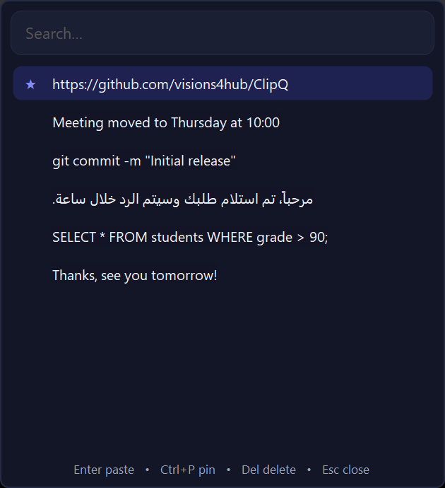
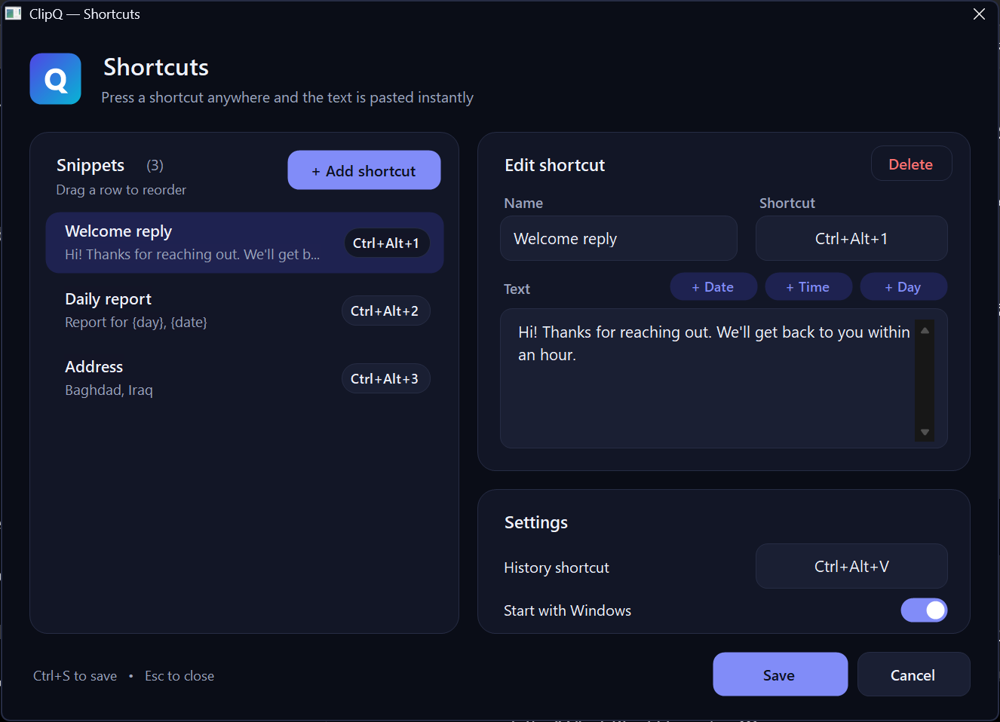

<div align="center">


# ClipQ

**Clipboard history and instant text snippets for Windows.**

Press a shortcut, pick anything you copied, and it's pasted right where you're typing.

**English** · [العربية](README.ar.md)

[](https://github.com/visions4hub/ClipQ/actions/workflows/build.yml)
[](https://github.com/visions4hub/ClipQ/releases/latest)

[](LICENSE)

[**⬇ Download (English)**](https://github.com/visions4hub/ClipQ/releases/latest/download/ClipQ-Setup-EN.exe) &nbsp;·&nbsp; [**⬇ تحميل (العربية)**](https://github.com/visions4hub/ClipQ/releases/latest/download/ClipQ-Setup-AR.exe)

</div>

---

## Screenshots

| Clipboard history (`Ctrl+Alt+V`) | Snippets & settings |
|:---:|:---:|
|  |  |

## Features

- **Clipboard history:** keeps the last 200 text items you copied. Open it anywhere, search, and paste.
- **Pin what matters:** pinned items stay at the top and survive clearing the history.
- **Snippets on a shortcut:** save text you type often and give each one its own global shortcut. It's pasted straight into the app you're using.
- **Smart placeholders:** `{date}`, `{time}` and `{day}` are filled in at the moment a snippet is pasted.
- **English and Arabic:** two editions, with a left-to-right English interface and a right-to-left Arabic one.
- **Respects passwords:** anything a password manager marks as private is never saved.
- **Private by design:** everything stays on your computer. ClipQ makes no network connections.
- **Native look:** follows Windows light/dark mode, with rounded Windows 11 frames and high-DPI support.
- **Lightweight:** one small app in the system tray. No admin rights needed.

## Install

1. Download the installer in your language from the [latest release](https://github.com/visions4hub/ClipQ/releases/latest):
   - English: [**ClipQ-Setup-EN.exe**](https://github.com/visions4hub/ClipQ/releases/latest/download/ClipQ-Setup-EN.exe)
   - Arabic: [**ClipQ-Setup-AR.exe**](https://github.com/visions4hub/ClipQ/releases/latest/download/ClipQ-Setup-AR.exe)
2. Run it and click **Yes**. ClipQ installs for your user only, so no admin rights are needed.
3. ClipQ starts right away. Its icon appears next to the clock, and it starts automatically with Windows from now on.

> **"Windows protected your PC"?** The installer isn't code-signed yet, so SmartScreen may warn you. Click **More info → Run anyway**. Every release is built from this source code by [GitHub Actions](https://github.com/visions4hub/ClipQ/actions), and the checksums are published in `SHA256SUMS.txt` with each release.

**Switching language:** run the other installer. It replaces the current edition and keeps your snippets and history.

**Requirements:** Windows 10 or 11 with .NET Framework 4.8. This is already included in Windows 10 (version 1903 and later) and Windows 11.

---

## How to use ClipQ

### 1. First launch

The first time ClipQ runs, it opens the **Shortcuts** window so you can set it up. You can close it and come back anytime: **left-click the ClipQ icon** next to the clock.

Right-click the tray icon for the menu:

| Menu item | What it does |
|---|---|
| **Shortcuts** | Opens the snippets & settings window |
| **Copy history** | Opens the history. Choosing an item here **copies** it, so you paste it yourself |
| **Clear history** | Deletes all unpinned items, after asking you |
| **Exit** | Closes ClipQ until you next sign in to Windows |

### 2. Clipboard history

ClipQ quietly saves every piece of text you copy (`Ctrl+C`), up to the last **200** items.

1. Click where you want to type: a chat, an email, a document.
2. Press **`Ctrl+Alt+V`**. The history opens next to your mouse.
3. Start typing to **search**, or move with the **↑ ↓** arrows.
4. Press **`Enter`** or **double-click** an item. The window closes, and the text is pasted where you were typing.

Inside the history window:

| Key | Action |
|---|---|
| `Enter` / double-click | Paste the selected item |
| `↑` `↓` | Move between items |
| `Ctrl+P` | Pin / unpin (pinned items show a ★ and stay at the top) |
| `Del` | Delete the selected item |
| `Esc` | Close |
| Right-click | Menu: Paste, Pin, Delete, Clear history |

> Copying the same text again moves it back to the top instead of duplicating it. Text copied from password managers is skipped automatically.

### 3. Snippets (text on a shortcut)

Snippets are texts you type over and over: a reply to customers, your address, account details, a daily report header. Give each one a shortcut, and it's typed for you anywhere.

**Add a snippet**

1. Left-click the tray icon to open the **Shortcuts** window.
2. Click **+ Add shortcut**.
3. **Name:** a label for you, such as "Welcome reply".
4. **Shortcut:** click the box, then **press the keys** you want, such as `Ctrl+Alt+1`.
   - A shortcut must include `Ctrl` or `Alt`, or be a function key (`F1` to `F24`). Plain letters aren't allowed, so they never block normal typing.
   - To remove a shortcut, click its box and press `Backspace`, `Del` or `Esc`.
5. **Text:** type the text to be pasted. It can be several lines.
6. Click **Save**, or press `Ctrl+S`.

Now press `Ctrl+Alt+1` in any app, and the text is pasted instantly.

**Placeholders.** Use the **+ Date**, **+ Time** and **+ Day** buttons above the text box to insert values that are filled in at the moment of pasting:

| Button | Inserts | Example result |
|---|---|---|
| + Date | `{date}` | `1/11/2026` (day/month/year) |
| + Time | `{time}` | `5:21 PM` |
| + Day | `{day}` | `Sunday` |

For example, `Report for {day}, {date}` becomes `Report for Sunday, 1/11/2026`.

**Manage snippets**

- **Edit:** select a snippet in the list on the left, then change it on the right.
- **Reorder:** drag any row up or down.
- **Delete:** select it and click **Delete**.
- **Cancel changes:** click **Cancel** or press `Esc`.

### 4. Settings

These are at the bottom-right of the **Shortcuts** window:

- **History shortcut:** change `Ctrl+Alt+V` to any combination you prefer.
- **Start with Windows:** turn automatic start on or off.

ClipQ warns you when a shortcut is a problem:
- if the same shortcut is used twice,
- if a snippet has text but no shortcut,
- or if another program already owns that shortcut. In that case, pick a different one.

---

## Your data

| What | Where |
|---|---|
| Program | `%LOCALAPPDATA%\Programs\ClipQ` |
| History & snippets | `%APPDATA%\ClipQ\history.json` and `settings.json` |

Nothing is ever uploaded. To back up your snippets, copy `settings.json`.

## Uninstall

Open **Settings → Apps → Installed apps**, find **ClipQ**, and choose **Uninstall**. You'll be asked whether to also delete your saved snippets and history.

Silent install and uninstall are supported too:

```bat
ClipQ-Setup-EN.exe /quiet
"%LOCALAPPDATA%\Programs\ClipQ\Uninstall.exe" /uninstall /quiet
```

## Build from source

No SDK or Visual Studio is needed. ClipQ builds with the C# compiler that ships with Windows (.NET Framework 4.8).

```bat
git clone https://github.com/visions4hub/ClipQ.git
cd ClipQ
build.bat
```

This produces both installers: `dist\ClipQ-Setup-EN.exe` and `dist\ClipQ-Setup-AR.exe`.

```
src/         The app: tray, clipboard listener, hotkeys, history popup, settings window
src/Lang.cs  Interface language: Arabic by default, English when built with /define:EN
installer/   Setup.cs: installs for the current user and doubles as the uninstaller
assets/      App icon
build.bat    Builds both editions and their installers
```

## Contributing

Bug reports and ideas are welcome. Please [open an issue](https://github.com/visions4hub/ClipQ/issues).

## License

[MIT](LICENSE) © Developer Team Gods
